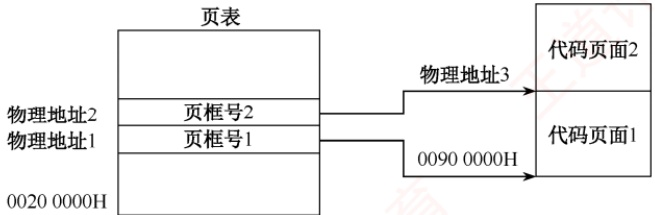
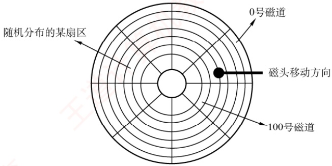

10.下列关于库函数和系统调用的区别与联系的说法中，错误的是（）。A. 系统调用用于请求内核服务，部分库函数通过系统调用实现功能B. 系统调用需要陷入内核态执行，而普通库函数（如字符串处理）通常在用户态执行C. 所有库函数的实现都依赖系统调用，没有系统调用则无法完成任何功能D. 库函数具有良好的可移植性，可跨平台使用；系统调用则与具体操作系统紧密耦合

11. 【2010统考真题】下列选项中，操作系统提供给应用程序的接口是（）。A. 系统调用 B. 中断 C. 库函数 D. 原语

## 1.1.5 答案与解析

## 单项选择题

## 01. C

操作系统管理计算机的硬件和软件资源，这些资源统称为计算机资源。注意，操作系统不仅管理处理机、存储器等硬件资源，还管理文件，文件不属于硬件资源，但属于计算机资源。

## 02. D

操作系统负责管理计算机系统的硬件和软件资源，包括CPU、内存、外存等，以提供高效、安全、抽象的运行环境。源程序虽以文件形式存储在外存中，但其具体内容（如代码语义、编程逻辑）并不属于操作系统管理的范畴。操作系统对文件的管理关注的是文件的逻辑组织、存储分配、访问控制及元数据（如文件名、大小、权限、创建时间等），而非文件内容的语义。因此，源程序作为具有特定语义的用户数据，其内容本身并非操作系统的管理对象。

## 03. D

操作系统管理计算机软/硬件资源，扩充裸机以提供功能更强大的扩充机器，并充当用户与硬件交互的中介。高级程序设计语言的编译器显然不是操作系统关心的问题。编译器的实质是一段程序指令，它存储在计算机中，是上述水杯中的水。

## 04. D

操作系统是指控制和管理整个计算机系统的硬件和软件资源，合理地组织、调度计算机的工作和资源的分配，以便为用户和其他软件提供方便的接口与环境的程序集合。选项A、B、C都可理解成应用程序为用户提供的服务，是应用程序的功能，而不是操作系统的功能。

## 05. C

并发性是指若干事件在同一时间间隔内发生，而并行性是指若干事件在同一时刻发生

## 06. B

系统调用是操作系统为应用程序使用内核功能所提供的接口。

## 07. C

操作系统为编程人员提供的接口是程序接口，即系统调用。

## 08. A

操作系统不允许用户直接操作各种硬件资源，因此用户程序只能通过系统调用的方式来请求内核为其服务，间接地使用各种资源。

## 09. D

操作系统是用来管理资源的程序，用户程序也是在操作系统的管理下完成的。配置了操作系统的机器与裸机相比，资源利用率大大提高。操作系统不能直接用来编程，选项D错误。

## 10. C

并非所有库函数都依赖系统调用。例如，字符串处理、数学计算等纯用户态操作完全在用户

空间中完成，无须陷入内核；只有涉及I/O、进程控制等资源访问的库函数才会调用系统调用。

## 11. A

操作系统接口主要有命令接口和程序接口（也称系统调用）。库函数是高级语言中提供的与系统调用对应的函数（也有些库函数与系统调用无关），目的是隐藏“访管”指令的细节，使系统调用更为方便、抽象。但是，库函数属于用户程序而非系统调用，是系统调用的上层。

## 1.2 操作系统发展历程

## 1.2.1 手工操作阶段（未配置操作系统）

## 1. 人工操作方式

早期阶段，用户将程序和数据穿孔在纸带或卡片上，装入输入设备后手动控制读入内存并启动程序运行。程序的装入、执行与结果输出等全过程均依赖人工操作。随着计算机硬件性能不断提升，人机速度之间的矛盾日益突出，系统资源利用率低下的问题也愈发严重。

手工操作阶段存在两个突出缺点:①用户独占全机，虽无资源竞争，但系统资源利用率极低；②CPU长时间空闲，等待人工完成I/O操作，导致其计算能力未能充分发挥。

为此，人们提出用高速设备替代人工操作，来控制作业流程。

## 2. 脱机 I/O 方式

为缓解人机速度不匹配以及CPU与外设之间的速度差异，诞生了脱机I/O技术。其核心思想是引入一台外围机（如小型专用计算机），在CPU不参与的情况下，预先完成I/O准备工作:输入时，外围机将纸带或卡片上的程序和数据读入磁带，供CPU后续调入内存；输出时，CPU将结果先写入磁带，再由外围机将磁带内容输出至外设。

由于I/O操作完全由外围机独立完成，脱离了主机的直接控制，故称为脱机I/O；相比之下由主机直接管理I/O设备的方式则称为联机I/O。

脱机I/O的主要优点包括:①装带、卸带及数据传输等操作在脱机状态下由外围机完成，显著减少了CPU空闲时间；②CPU可直接从高速磁带读取或写入数据，大幅提升了I/O效率。

## 1.2.2 批处理阶段（操作系统开始出现）

在脱机I/O技术的基础上，为实现作业的自动连续处理并进一步提升CPU与系统资源的利用率，批处理系统应运而生。按发展历程，可分为单道批处理系统和多道批处理系统。

考点追踪批处理系统的特点（2016）

## 1. 单道批处理系统

为实现对作业的连续处理，系统先将一批作业以脱机方式输入到磁带，并配备一个监督程序(Monitor)。在其控制下，作业能自动、顺序地逐个运行。尽管作业成批提交，但内存中始终仅驻留一道用户程序。单道批处理系统的主要特征如下:

1）自动性。在正常情况下，磁带上的作业可自动连续执行，无须人工干预。

2）顺序性。作业按磁带上的顺序依次装入内存，先装入者先完成。

3）单道性。内存中仅允许一道用户程序运行；监督程序每次仅从磁带调入一道作业，待其完成或异常终止后才装入下一道。

## 二、综合应用题

01. 有两个程序，程序 A 依次使用 CPU 计10s、设备甲计 5s、CPU 计 5s、设备乙计10s、CPU计 10s；程序 B 依次使用设备甲计10s、CPU 计10s、设备乙计 5s、CPU 计 5s、设备乙计10s。假设先执行程序A再执行程序B，在单道程序环境下，CPU的利用率是多少？在多道程序环境下，CPU的利用率是多少？

02. 设某计算机系统有一个CPU、一台输入设备、一台打印机。现有两个进程同时进入就绪态，并且进程A先得到CPU运行，进程B后运行。进程A的运行轨迹为:计算 50ms，打印信息100ms，再计算50ms，打印信息100ms，结束。进程B的运行轨迹为:计算50ms，输入数据80ms，再计算100ms，结束。画出它们的甘特图，并说明:

1）开始运行后，CPU有无空闲等待？若有，在哪段时间内等待？计算CPU的利用率。

2）进程A运行时有无等待现象？若有，则在何时发生等待现象？

3）进程B运行时有无等待现象？若有，则在何时发生等待现象？

## 1.2.8 答案与解析

## 一、单项选择题

## 01. D

脱机技术是指在主机以外的设备上进行输入/输出操作，需要时再送主机处理，以提高设备的利用率。虚拟技术与交换技术以多道程序设计技术为前提。多道程序设计技术同时在主存中运行多个程序，在一个程序等待时，可以去执行其他程序，因此提高了系统资源的利用率。

## 02. D

批处理系统中，作业执行时用户无法干预其运行，只能通过事先编制作业控制说明书来间接干预，缺少交互能力，也因此才有了分时操作系统的出现。

## 03. C

多道程序的运行环境比单道程序的运行环境更加复杂。引入多道程序后，程序的执行就失去了封闭性和顺序性。程序执行因为共享资源及相互协同的原因产生了竞争，相互制约。

考虑到竞争的公平性，程序的执行是断续的。

## 04. B

操作系统的基本类型主要有批处理操作系统、分时操作系统和实时操作系统。

## 05. B

实时操作系统要求能实时处理外部事件，即在规定的时间内完成对外部事件的处理。

## 06. B

实时性和可靠性是实时操作系统最重要的两个目标，而安全可靠体现了可靠性，快速处理和及时响应体现了实时性。资源利用率不是实时操作系统的主要目标，即为了保证快速处理高优先级任务，允许“浪费”一些系统资源。

## 07. D

实时操作系统主要应用在需要对外界输入立即做出反应的场合，不能有拖延，否则会产生严重后果。本题的选项中，航空订票系统需要实时处理票务，因为票额数据库的数量直接反映了航班的可订机位。机床控制也要实时，不然会出差错。股票交易行情随时在变，若不能实时交易会出现时间差，使交易出现偏差。

## 08. A

分时操作系统主要用于交互式作业而非批处理作业。分时操作系统中每个任务依次轮流使用

Ⅲ. 初始化中断向量表 IV. 保存中断屏蔽字A. 仅I、ⅡI B. 仅I、ⅡI、IV C. 仅ⅢI、IV D. 仅II、III、IV

28. 【2021统考真题】下列指令中，只能在内核态执行的是（）。A. Trap 指令 B. I/O 指令 C. 数据传送指令 D. 设置断点指令

29. 【2021统考真题】下列选项中，通过系统调用完成的操作是（）。A. 页置换 B. 进程调度 C. 创建新进程 D. 生成随机整数

30.【2022统考真题】下列关于CPU模式的叙述中，正确的是（）。A. CPU处于用户态时只能执行特权指令B. CPU处于内核态时只能执行特权指令C. CPU处于用户态时只能执行非特权指令D. CPU处于内核态时只能执行非特权指令

31. 【2022统考真题】执行系统调用的过程涉及下列操作，其中由操作系统完成的是（）。I. 保存断点和程序状态字 I. 保存通用寄存器的内容Ⅲ. 执行系统调用服务例程 IV. 将 CPU 模式改为内核态A. 仅I、II B. 仅Ⅱ、III C. 仅ⅡI、IV D. 仅ⅡI、III、IV

32. 【2023统考真题】在操作系统内核中，中断向量表适合采用的数据结构是（）。A. 数组 B. 队列 C. 单向链表 D. 双向链表

33.【2024统考真题】下列关于中断、异常和系统调用的叙述中，错误的是（）。A. 中断或异常发生时，CPU处于内核态B. 每个系统调用都有对应的内核服务例程C. 中断处理程序开始执行时，CPU处于内核态D. 系统添加新类型设备时，需要注册相应的中断服务例程

## 1.3.6 答案与解析

## 单项选择题

## 01. B

说法I错误:通用操作系统使用时间片轮转调度算法，用户运行程序并不需要预先预订运行时间。说法Ⅱ正确:操作系统执行程序时，必须从起始地址开始执行。说法Ⅲ错误:编译器是操作系统的上层软件，不是操作系统需要提供的功能。说法IV正确:操作系统是计算机资源的管理者，管理计算机系统资源是操作系统关心的主要问题。

02. C

说法I错误:批处理的主要缺点是缺少交互性。批处理系统的主要缺点是常考点，读者对此要非常敏感。说法Ⅱ正确:输入/输出指令属于特权指令，只能由操作系统使用，因此必须在内核态下执行。说法Ⅲ错误:多道性是为了提高系统利用率和吞吐量而提出的。说法IV正确:I/O通道实际上是一种特殊的处理器，它具有执行I/O指令的能力，并通过执行通道程序来控制I/O操作。

03. C

系统调用需要触发陷入指令，如基于x86的Linux系统，该指令为int 0x80或sysenter，说法I正确。程序设计无法形成屏蔽中断指令，说法Ⅱ错误。用户程序通过系统调用进行进程控制，说法Ⅲ正确。执行系统调用时CPU状态要从用户态转到内核态，这是通过中断来实现的，当系统调用返回后，继续执行用户程序，同时CPU状态也从内核态转到用户态，说法IV正确。

## 04. C

中断是操作系统必须提供的功能，因为计算机的各种错误都需要中断处理，内核态与用户态

C. 硬盘分区表 D. 文件系统的索引节点表

21. 【2023统考真题】与宏内核操作系统相比，下列特征中，微内核操作系统具有的是（）。I. 较好的性能 Ⅱ. 较高的可靠性 . 较高的安全性 IV. 较强的可扩展性A. 仅Ⅱ、IV B. 仅I、Ⅱ、ⅢII C. 仅I、III、IV D. 仅II、ⅢII、IV

22.【2025统考真题】下列关于虚拟化技术的叙述中，错误的是（）。A. 操作系统可以运行在虚拟机上B. 虚拟化技术支持在一台计算机上构建多个虚拟机C. 虚拟机监控程序（VMM）与操作系统的特权级相同D. 虚拟化技术支持在一台计算机上模拟不同的指令集体系结构

## 1.6.3 答案与解析

## 单项选择题

## 01. A

分层式结构简化了系统的设计和实现，每层只能调用紧邻它的低层的功能和服务，便于系统的调试和验证，若在调试某层时发现错误，则错误应在这层上，这是因为其低层都已调试好。

## 02. C

单向依赖是分层式OS的特点。分层式OS中增加或替换一个层中的模块或整层时，只要不改变相应层间的接口，就不会影响其他层，因而易于扩充和维护。层次定义好后，相当于各层之间的依赖关系也就固定了，因此往往显得不够灵活，选项C错误。每执行一个功能，通常都要自上而下地穿越多层，增加了额外的开销，导致系统效率降低。

## 03. B

模块化操作系统的各功能模块都在内核中，并且模块之间相互调用、相互依赖，任何一个模块出错，都可能导致整个内核崩溃。选项B的设置属于“移花接木”，正确的说法应该是:在微内核操作系统中，内核外的某个功能模块出错不会导致整个系统崩溃，可靠性高。

## 04. C

微内核和宏内核作为两种对立的结构，它们的优缺点也是对立的。微内核OS的主要缺点是性能问题，因为需要频繁地在内核态和用户态之间进行切换，因而切换开销偏大。

## 05. B

功能分层设计是分层式OS的特点。通常可以从四个方面来描述微内核OS:①内核足够小；②基于客户/服务器模式；③应用“机制与策略分离”原理；④采用面向对象技术。

## 06. C

进程（线程）之间的通信功能是微内核最频繁使用的功能，因此几乎所有微内核OS都将其放入微内核。低级I/O和硬件紧密相关，因此应放入微内核。低级进程管理和调度属于调度功能的机制部分，应将它放入微内核。微内核OS将与硬件紧密相关的一小部分放入微内核处理，此时微内核的主要功能是捕获所发生的中断和陷入事件，并进行中断响应处理，识别中断或陷入的事件后，再发送给相关的服务器处理，所以中断和陷入处理也应放入微内核。而文件系统服务是放在微内核外的文件服务器中实现的，所以仅选项V不宜放在微内核中。

## 07. C

微内核结构需要频繁地在内核态和用户态之间进行切换，操作系统的执行开销相对偏大，那些移出内核的操作系统代码根据分层的原则被划分成若干服务程序，它们的执行相互独立，交互则都借助微内核进行通信，影响了系统的效率，因此说法Ⅰ不是优势。因为内核的服务变少，且一般来写数据段、只读代码段等区域，其布局如下图所示，图中阴影部分表示未占用区域。现有C语言程序的部分代码如下。 K

```c
char *ptr;
内核区
void main()
王道
用户栈
int length;
ptr = (char *)malloc(100);
scanf("%s", ptr); 运行时堆
length = strlen(ptr);
可读写数据段
printf("length = %d\n", length);
free(ptr); 只读代码段
```

1）上述程序执行时，其进程控制块位于哪个区域？执行scanf()等待键盘输入时，该进程处于什么状态？

2）main()函数的代码位于哪个区域？其直接调用的哪些函数的功能需通过执行驱动程序实现？

3）变量ptr被分配在哪个区域？若变量length未被分配在寄存器中，则会被分配在哪个区域？ptr指向的字符串位于哪个区域？

## 2.1.10 答案与解析

## 一、单项选择题

## 01. C

进程映像是PCB、程序段和数据的组合，其中PCB是进程存在的唯一标志。

## 02. C

每个进程包含独立的地址空间，进程各自的地址空间是私有的，只能执行自己地址空间中的程序，且只能访问自己地址空间中的数据，相互访问会导致指针的越界错误（学完内存管理将有更好的认识）。因此，进程之间不能直接交换数据，但可利用操作系统提供的共享文件、消息传递、共享存储区等进行通信。

## 03. A

动态性是进程最重要的特性，以此来区分文件形式的静态程序。操作系统引入进程的概念，是为了从变化的角度动态地分析和研究程序的执行。

## 04.A

进程是一个独立的运行单位，也是操作系统进行资源分配和调度的基本单位，它包括PCB、程序和数据以及执行栈区，仅仅说进程是在多程序环境下的完整程序是不合适的，因为程序是静态的，它以文件形式存放在计算机的硬盘内，而进程是动态的。

## 05. D

并发进程可能因等待资源或因被抢占CPU而暂停运行，其生命周期是不连续的。执行速度会影响进程之间的执行顺序和内存冲突问题，从而导致不同的操作结果。并发进程之间存在相互竞争和制约，导致每次运行可能得到不同的结果，选项D正确。

## 06. A

选项B错在优先级分静态和动态两种，动态优先级是根据运行情况而随时调整的。选项C错在系统发生死锁时有可能进程全部都处于阻塞态，CPU空闲。选项D错在进程申请处理器得不到满足时就处于就绪态，等待处理器的调度。

## 07. C

并发进程执行的相对速度与进程调度策略有关，因为进程调度策略决定了哪些进程可以获得处理机，以及获得处理机的时间长短，从而影响进程执行的速度和效率。

## 08. C

进程创建原语的执行过程:申请空白PCB，并为新进程申请唯一的数字标识符。为新进程分配资源，包括内存、I/O设备等。初始化PCB，将新进程插入就绪队列。从上述过程可以看出，为进程分配CPU不是由进程创建原语完成的，而是由进程调度实现的。

## 09. B

一个进程可以顺序地执行一个或多个程序，只要在执行过程中改变其CPU状态和内存空间即可，但不能同时执行多个程序，选项B错误，选项A正确。一个程序可以对应多个进程，即多个进程可以执行同一个程序。例如，同一个文本编辑器可以被多个用户或多个窗口同时运行，每次运行都形成一个新进程。一个程序在执行过程中也可产生多个进程。例如，一个程序可以通过系统调用fork()或 create()来创建子进程，从而实现并发处理或分布式计算。选项C和D正确。

## 10. D

用户登录时，操作系统会为用户创建一个登录进程，用于验证用户身份和提供用户界面。高级调度即作业调度，会从后备队列上选择一个作业调入内存，并为之创建相应的进程。操作系统响应用户提出的请求时，通常会为用户创建一个子进程，用于执行用户指定的任务或程序。用户打开一个浏览器程序时，也是一种操作系统响应用户请求的情况，同样会创建一个新进程。

## 11. B

在进程的整个生命周期中，系统总是通过其PCB对进程进行控制。也就是说，系统是根据进程的PCB而非任何其他因素来感知到进程存在的，PCB是进程存在的唯一标志。同时PCB常驻内存。A和D选项的内容都包含在进程PCB中。

## 12. C

一个进程的状态变化可能引起另一个进程的状态变化。例如，一个进程时间片用完，可能引起另一个就绪进程的运行。同时，一个进程的状态变化也可能不会引起另一个进程的状态变化。例如，一个进程由阻塞态转换为就绪态就不会引起其他进程的状态变化。

## 13. C

在单处理器系统中，不可能出现10个进程都处于就绪态的情况。但9个进程处于就绪态、1个进程处于运行态是可能的。此外还要想到，可能10个进程都处于阻塞态。

## 14. C

由于打印机是独占资源，当一个进程释放打印机后，另一个等待打印机的进程就可能从阻塞态转到就绪态。当然，也存在一个进程执行完毕后由运行态转换为终止态时释放打印机的情况，但这并不是由于释放打印机引起的，相反是因为运行完成才释放了打印机。

## 15. D

I/O操作完成之前进程在等待结果，状态为阻塞态；完成后进程等待事件就绪，变为就绪态。

## 16. C

只有就绪态可以既由运行态转变过去又能由阻塞态转变过去。时间片到时，运行态变为就绪态；当所需要资源到达时，进程由阻塞态转换为就绪态。

## 17. B

分时系统中处于就绪态的进程最多，这些进程都在争夺CPU的使用权，而CPU的数量是有

2）使用 nice, cpuTime和 waitTime设计一种动态优先数计算方法，以避免产生饥饿现象，并说明 waitTime 的作用。 KK

## 2.2.9 答案与解析

## 一、单项选择题

## 01. D

中级调度的主要目的是节省内存，将内存中处于阻塞态或长期不运行的进程挂起到外存，从而腾出空间给其他进程使用。当这些进程重新具备运行条件时，再从外存调入内存，恢复运行。

## 02. C

进程从创建态转换到就绪态是由高级调度完成的。高级调度（作业调度）的主要任务是从后备队列中选择一个或一批作业，为其创建PCB，分配内存等其他资源，并将其插入就绪队列。

## 03. B

设计调度算法时应考虑的指标有很多，比较常见的有公平性、资源利用率、平均周转时间、平均等待时间、平均响应时间。互斥性不是调度算法设计时需要考虑的指标，而是一种同步机制，用来保证多个进程访问临界资源时不会发生冲突。

## 04. A

时间片轮转的主要目的是，使得多个交互的用户能够得到及时响应，使得每个用户以为“独占”计算机的使用，因此它并没有偏好，也不会对特殊进程做特殊服务。时间片轮转增加了系统开销，所以不会使得系统高效运转，吞吐量和周转时间均不如批处理。但其较快速的响应时间使得用户能够与计算机进行交互，改善了人机环境，满足用户需求。

## 05. C

进程调度的时机与进程特点有关，如进程是CPU繁忙型还是I/O繁忙型、自身的优先级等。但仅有这些特点是不够的，能否得到调度还取决于进程调度策略，若采用优先级调度算法，则进程的优先级才起作用。至于占用处理器运行时间的长短，则要看进程自身，若进程是I/O繁忙型，运行过程中要频繁访问I/O端口，即可能频繁放弃CPU，所以占用CPU的时间不会长，一旦放弃CPU，则必须等待下次调度。若进程是CPU繁忙型，则一旦占有CPU，就可能运行很长时间，但运行时间还取决于进程调度策略，大部分情况下，交互式系统为改善用户的响应时间，大多数采用时间片轮转调度算法，这种算法在进程占用CPU达到一定时间后，会强制将其换下，以保证其他进程的CPU使用权。因此选择选项C。

## 06. D

处于临界区的进程也可能因中断或抢占而导致调度。此外，若进程在临界区内请求的是一个需要等待的资源，比如打印机，则它主动放弃CPU，让其他进程运行。

## 07. C

当一个进程被执行时，CPU的所有寄存器中的值（进程的现场信息）、进程的状态和控制信息以及堆栈中的内容被称为该进程的上下文。中断向量不属于进程上下文的一部分，而是一组指向中断处理程序的指针，存放在内存的固定位置。

## 08. D

上下文切换发生在操作系统调度一个新进程到处理器上运行的时候。一个重要的上下文信息就是程序计数器（PC）的值，当前进程被打断的PC值作为寄存器上下文的一部分保存在进程现场信息中。进程上下文切换过程中不涉及主存和磁盘的数据交换，选项D错误。

## 09. C

当线程切换时，操作系统需要保存当前线程的程序计数器的值，并恢复新线程的程序计数器，以便从新线程的正确位置开始执行。在多线程条件下，每个线程拥有各自独立的栈，当线程切换时，需要保存当前线程的栈基址寄存器的值，并加载新线程的栈基址，以便正确管理栈空间。同一个进程中的线程共享进程的虚拟地址空间，因此不需要更新页基址寄存器的值。一个进程所打开的文件也是被这个进程中的所有线程共享的，因此不需要更新进程打开文件表。

## 10. B

FCFS调度算法比较有利于长作业，而不利于短作业。CPU繁忙型作业是指该类作业需要占用很长的 CPU时间，而很少请求I/O操作，因此CPU繁忙型作业类似于长作业，采用FCFS可从容完成计算。I/O繁忙型作业是指作业执行时需频繁请求I/O操作，即可能频繁放弃CPU，所以占用CPU的时间不会太长，一旦放弃CPU，则必须重新排队等待调度，所以采用SJF比较适合。时间片轮转调度算法对于短作业和长作业的时间片都一样，所以地位也几乎一样。优先级调度有利于优先级高的进程，而优先级和作业时间长度是没有必然联系的。因此选择选项B。

## 11. D

在选择进程调度算法时应考虑以下几个准则:①公平:确保每个进程获得合理的CPU份额；②有效:使CPU尽可能地忙碌；③响应时间:使交互用户的响应时间尽可能短；④周转时间:使批处理用户等待输出的时间尽可能短；⑤吞吐量:使单位时间处理的进程数尽可能最多。由此可见选项D不正确。

## 12. C

实时系统必须能足够及时地处理某些紧急的外部事件，因此普遍用高优先级，并用“可抢占”来确保实时处理。

## 13. D

操作系统选择新进程的直接原因是当前运行的进程不能继续运行。当运行的进程由于时间片用完、运行结束、出错、需要等待事件的发生、自我阻塞等，均可以激活调度程序进行重新调度，选择就绪队列的队首进程投入运行。新进程加入就绪队列不是引起调度的直接原因，当CPU正在运行其他进程时，该进程仍需等待。即使是在采用高优先级调度算法的系统中，一个最高优先级的进程进入就绪队列，也需要考虑是否允许抢占，当不允许抢占时，仍需等待。

## 14. D

进程（线程）调度的时机包括:运行的进程（线程）运行完毕、运行的进程（线程）自我阻塞、运行的进程（线程）的时间片用完、运行的进程（线程）所需的资源没有准备好（会阻塞进程）、运行的进程（线程）出现错误（会终止进程）。因此，说法I、Ⅱ、Ⅲ、IV和V都正确。

## 15. B

4个作业的周转时间分别是2h,4h,6h,8h，所以4个作业的总周转时间为 $2+4+6+8=20$此时，平均周转时间 = 各个作业周转时间之和/作业数 =20/4= 5 小时。

## 16.B、E、C、D

照顾短作业用户，选择短作业优先调度算法；照顾紧急作业用户，即选择优先级高的作业优先调度，采用基于优先级的剥夺调度算法；实现人机交互，要保证每个作业都能在一定时间内轮到，采用时间片轮转调度算法法；使各种作业用户满意，要处理多级反馈，所以选择多级反馈队列调度算法。

## 17. D

优先级调度算法分静态和动态两种。静态优先级在进程创建时确定，之后不再改变。

## 18. B

系统采用短作业优先调度算法，作业的执行顺序为 $\mathrm { J } _ { 1 } , \mathrm { J } _ { 2 } , \mathrm { J } _ { 3 } , \mathrm { J } _ { 1 }$ 的周转时间为 $T _ { 1 } , \mathrm { ~ J } _ { 2 }$ 的周转时间为$T _ { 1 }   + T _ { 2 }$ ${ \bf J } _ { 3 }$ 的周转时间为 $T _ { 1 } + T _ { 2 } + T _ { 3 }$ ，则平均周转时间为 $(T_{1}+T_{1}+T_{2}+T_{1}+T_{2}+T_{3})/3=(3T_{1}+2T_{2}+T_{3})/3$ 0

现有铁锹和水桶各1个，铁锹用于挖树坑和填土，水桶用于浇水。当树坑的数量小于3时，甲才可以挖树坑。假设初始时树坑的数量为0，铁锹和水桶均可用。请定义尽可能少的信号量，用wait()、signal()操作描述植树过程中三人之间的同步或互斥关系，并说明所用信号量的作用及其初值。

## 2.3.9 答案与解析

## 一、单项选择题

## 01. D

多个进程可以共享系统中的资源，一次仅允许一个进程使用的资源称为临界资源。访问临界资源的那段代码称为临界区。

## 02. D

在多道程序技术中，信号量机制是一种有效实现进程同步和互斥的工具。进程执行的前趋关系实质上是指进程的同步关系。除此之外，只有进程的并发执行不需要信号量来控制。

## 03. A

信号量是一个特殊的整型变量，只有初始化和PV操作才能改变其值。通常，信号量分为互斥量和资源量，互斥量的初值一般为1，表示临界区只允许一个进程进入，从而实现互斥。当互斥量等于0时，表示临界区已有一个进程进入，临界区外尚无进程等待；当互斥量小于0时，表示临界区中有一个进程，互斥量的绝对值表示在临界区外等待进入的进程数。同理，资源信号量的初值可以是任意整数，表示可用的资源数，当资源量小于0时，表示所有资源已全部用完，而且还有进程正在等待使用该资源，等待的进程数就是资源量的绝对值。

## 04. C

进程进入临界区必须满足互斥条件。当进程已进入临界区但尚未离开时，若被迫进入阻塞状态，这是允许的，系统中常出现此类情形。在此状态下，只要其他进程在运行过程中不试图进入该临界区，就应允许其获得CPU并继续执行。该进程所锁定的临界区不允许其他进程访问；若其他进程尝试进入，必将在临界区的“锁”上阻塞，等待该进程下次运行时退出并释放临界区。

## 05. C

一张飞机票不能售给不同的旅客，因此飞机票是互斥资源，其他因素只是为完成飞机票订票的中间过程，与互斥资源无关。 X

## 06. D

所谓临界区，并不是指临界资源，如共享的数据、代码或硬件设备等，而是指访问临界资源的那段代码程序，如P/V操作、加减锁等。操作系统访问临界资源时，关心的是临界区的操作过程，具体对临界资源做何操作是应用程序的事情，操作系统并不关心。

## 07. D

同步机制的4个准则是空闲让进、忙则等待、让权等待和有限等待。

## 08. B

临界资源是互斥共享资源，非共享数据不属于临界资源。打印机、共享变量和共享缓冲区都只允许一次供一个进程使用。 K

## 09. B

临界资源是指必须互斥访问的资源，若并发使用将导致数据混乱或逻辑错误。磁盘虽为共享设备，但其访问由操作系统统一协调，不构成临界资源；公用队列被多个进程共享，若无互斥控制，同时操作会导致队列结构破坏或数据错乱，属于典型临界资源；私用数据仅限单个进程使用，不存在竞争；可重入的程序代码不含全局状态，允许多进程并发执行，无须互斥。

## 10. C

同步是指为了完成某项任务而建立的多个进程的相互合作关系，由于并发进程的执行是异步的（按各自独立的、不可预知的速度向前推进），需要保证进程之间操作的先后次序的约束。例如，读进程和写进程对同一段缓冲区的读和写就需要进行同步，以保证正确的执行顺序。

## 11. C

并发进程因共享资源而产生相互制约，可分为两类:①互斥关系，指进程竞争使用独占资源（互斥资源）所形成的制约；②同步关系，指进程为协同工作而需交换信息、相互等待所形成的制约。本题中，两个进程之间的制约属于同步关系，进程B必须等待进程A将数据写入缓冲区后，才能从中读取数据。同时，缓冲区是共享资源，其访问必须互斥，因此二者也存在互斥关系。

## 12. D

P、V操作是一种低级的进程通信原语，它是不能被中断的。

## 13. C

P操作即wait操作，表示等待某种资源直到可用。若这种资源暂时不可用，则进程进入阻塞态。注意，执行P操作时的进程处于运行态。

## 14. D

原语顾名思义，就是原子性的、不可分割的操作。其严格定义为:由若干机器指令构成的完成某种特定功能的一段程序，其执行必须是连续的，在执行过程中不允许被中断。

## 15. A

管程定义了一个数据结构和能为并发进程所执行（在该数据结构上）的一组操作，这组操作能同步进程并改变管程中的数据。

## 16. C

只有就绪进程能获得处理器资源，被唤醒的进程并不能直接转换为运行态。

## 17. B

互斥信号量的初值设置为1，P操作成功则将其减1，禁止其他进程进入；V操作成功则将其加1，允许等待队列中的一个进程进入。

## 18. D

与互斥信号量初值一般置1不同，用P,V操作实现进程同步时，信号量的初值应根据具体情况来确定。若期望的消息尚未产生，则对应的初值应设为0；若期望的消息已存在，则信号量的初值应设为一个非0的正整数。 KK

## 19. C

若代码可被多个进程在任意时刻共享，则要求任意一个进程在调用此段代码时都以同样的方式运行；而且进程在运行过程中被中断后再继续执行，其执行结果不受影响。这必然要求代码不能被任何进程修改，否则无法满足共享的要求。这样的代码就是可重入代码，也称纯代码，即允许多个进程同时访问的代码。

## 20. D

共享程序段可能同时被多个进程使用，所以必须可重入编码，否则无法实现共享的功能。

## 21. D

互斥锁可用于多线程或多进程之间，但只有对它加锁的线程或进程才能解锁它。若一个线程或进程试图解锁一个不属于它（加锁）的互斥锁，则返回错误码。

## 22. C

若两个线程分别对两个不同的互斥锁先后加锁，但顺序相反，则可能导致死锁，这是典型

使用银行家算法回答下面的问题:

1）Need矩阵是怎样的？

2）系统是否处于安全状态？如安全，请给出一个安全序列。

3）若从进程 $\mathrm { P } _ { 1 }$ 发来一个请求(0,4,2,0)，这个请求能否立刻被满足？如安全，请给出一个安全序列。

05. 假设具有 5 个进程的进程集合 $\mathbf{P} = \{ \mathbf{P}_{0}, \mathbf{P}_{1}, \mathbf{P}_{2}, \mathbf{P}_{3}, \mathbf{P}_{4} \}$ ，系统中有三类资源 A, B, C，假设在某时刻有如下状态:

<table><tr><td rowspan=2>进程名</td><td colspan=3>Allocation</td><td colspan=3>Max</td><td colspan=3>Available</td></tr><tr><td>A</td><td>B</td><td>C</td><td>A</td><td>B</td><td>C</td><td>A</td><td>B</td><td>C</td></tr><tr><td> $\mathrm { P _ { 0 } }$ </td><td>0</td><td>0</td><td>3</td><td>0</td><td>0</td><td>4</td><td rowspan=5>1</td><td rowspan=5>4</td><td rowspan=5>0</td></tr><tr><td> $\mathrm { P _ { 1 } }$ </td><td>1</td><td>0</td><td>0</td><td>1</td><td>7</td><td>5</td></tr><tr><td> $\mathrm { P } _ { 2 }$ </td><td>1</td><td>3</td><td>5</td><td>2</td><td>3</td><td>5</td></tr><tr><td> $\mathrm { P } _ { 3 }$ </td><td>0</td><td>0</td><td>2</td><td>0</td><td>6</td><td>4</td></tr><tr><td> $\mathrm { P } _ { 4 }$ </td><td>0</td><td>0</td><td>1</td><td>0</td><td>6</td><td>5</td></tr></table>

当前系统是否处于安全状态？若系统中的可利用资源 Available为(0,6, 2)，系统是否安全？若系统处在安全状态，请给出安全序列；若系统处在非安全状态，简要说明原因。

## 2.4.7 答案与解析

## 一、单项选择题

## 01. C

引起死锁的4个必要条件是:互斥、占有并等待、非剥夺和循环等待。本题中，出现了循环等待的现象，意味着可能导致死锁。进程释放资源不会导致死锁，进程自己进入死循环只能产生“饥饿”，不涉及其他进程。共享型设备允许多个进程申请使用，因此不会造成死锁。再次提醒，死锁一定要有两个或两个以上的进程才会导致，而饥饿可能由一个进程导致。

## 02. C

信号量机制能确保临界资源的互斥访问，不能完全避免死锁，选项A错误。同时检查两支筷子是否可用的方法可以预防死锁，但是会导致资源浪费，因为可能有一些空闲的筷子无法使用，但拿到筷子的哲学家用完餐后，释放筷子，其他哲学家就可以正常用餐，因此不会导致饥饿现象，选项B错误。若限制允许拿起筷子的哲学家数量，则不被允许的哲学家左边的哲学家一定可以拿到两边的筷子，从而破坏“循环等待”条件，选项C正确。对哲学家顺序编号，奇数号哲学家先拿左筷子，然后拿右筷子，而偶数号哲学家刚好相反，则相邻的哲学家总有一个可以拿起两边的筷子，但这破坏的是“循环等待”条件，而不是“互斥条件”，选项D错误。

## 03. C

进程的执行优先级并不能破坏死锁的四个必要条件。即使有高优先级和低优先级的进程，若它们都请求或占有了不可抢占的资源，且形成了环路等待，则死锁仍可能发生。选项A可以破坏请求并保持条件，选项B可以破坏互斥条件，选项D可以破坏循环等待条件。

## 04. B

发生死锁的4个必要条件:互斥、占有并请求、非剥夺和循环等待。一次分配所有资源的方法是当进程需要资源时，一次性提出所有的请求，若请求的所有资源均满足，则分配，只要有一项不满足，就不分配任何资源，该进程阻塞，直到所有的资源空闲后，满足进程的所有需求时再分配。这种分配方式不会部分地占有资源，因此打破了死锁的4个必要条件之一，实现了对死锁的预防。但是，这种分配方式需要凑齐所有资源，因此当一个进程所需的资源较多时，资源的利用率会较低，甚至会造成进程“饥饿”。

## 05. A

系统死锁的可能原因主要是时间上和空间上的。时间上由于进程运行中推进顺序不当，即调度时机不合适，不该切换进程时进行了切换，可能造成死锁；空间上的原因是对独占资源分配不当，互斥资源部分分配又不可剥夺，极易造成死锁。那么，为什么系统资源不足不是造成死锁的原因呢？系统资源不足只会对进程造成“饥饿”。例如，某系统只有三台打印机，若进程运行中要申请四台，则显然不能满足，该进程会永远等待下去。若该进程在创建时便声明需要四台打印机，则操作系统立即就会拒绝，这实际上是资源分配不当的一种表现。不能以系统资源不足来描述剩余资源不足的情形。

## 06. D

死锁避免是指在资源动态分配过程中用某些算法加以限制，防止系统进入不安全状态从而避免死锁的发生。选项B是避免死锁后的结果，而不是措施的原理。

## 07. D

资源有序分配策略可以限制循环等待条件的发生。选项A判断是否为不安全状态；选项B破坏了占有请求条件；选项C破坏了非剥夺条件。

## 08. C

PV操作不能破坏死锁条件，反而可能加强互斥和占有并等待条件。选项B同理。选项C可以破坏请求并保持条件。选项D只能在系统出现死锁时检测，却不能防止系统出现死锁。

## 09. B

资源数为9时，存在三个进程都占有三个资源，为死锁；资源数为10时，必然存在一个进程能拿到4个资源，然后可以顺利执行完其他进程。

## 10. B

考虑极端情况:每个进程已经分配了两台磁带机，那么其中任何一个进程只要再分配一台磁带机即可满足它的最大需求，该进程总能运行下去直到结束，然后将磁带机归还给系统再次分配给其他进程使用。因此，系统中只要满足 $2 X + 1 = 1 1$ 这个条件即可认为系统不会死锁，解得X=5，也就是说，系统中最多可以并发5个这样的进程是不会死锁的。或者，根据死锁公式，资源数大于进程个数乘以“每个进程需要的最大资源数减1”就不会发生死锁，即 $m > n(w - 1)$ ，其中 m是磁带机的数量，n是进程的数量，w是每个进程最多请求的磁带机数量。代入可得 $1 1 > n ( 3 - 1 )$即n< 5.5，n是正整数，因此系统必然不会死锁的最大n值是5。

## 11. A

A项的每个进程只申请一个资源，破坏了请求并保持条件，必然不会发生死锁。或者，根据死锁公式，假设系统共有m个资源，n个进程，每个进程需要k个资源，若满足 $m   >   n ( k   -   1 )$ ，则系统一定不会发生死锁，代入公式可知选项B、C、D均可能发生死锁。

## 12. D

解除死锁的方法有，①剥夺资源法:挂起某些死锁进程，并抢占它的资源，将这些资源分配给其他的死锁进程；②撤销进程法:强制撤销部分甚至全部死锁进程并剥夺这些进程的资源。

## 13. B

资源剥夺法允许一个进程强行剥夺其他进程所占有的系统资源。而撤销进程强行释放一个进程已占有的系统资源，与资源剥夺法同理，都通过破坏死锁的“请求和保持”条件来解除死锁。拒绝分配新资源只能维持死锁的现状，无法解除死锁

量是256KB，描述主存分配情况的位示图如下图所示（0表示未分配，1表示已分配），此时作业调度程序选中一个长为5.2KB的作业投入内存。试问:

1）为该作业分配内存后（分配内存时，首先分配低地址的内存空间），请填写该作业的页表内容。

2）页式存储管理有无内存碎片存在？若有，会存在哪种内存碎片？为该作业分配内存后，会产生内存碎片吗？若产生，则大小为多少？

3）假设一个64MB内存容量的计算机，采用页式存储管理（页面大小为4KB），内存分配采用位示图方式管理，请问位示图将占用多大的内存？

$$
\begin{array}{c}\hline\hline1 \quad 1 \quad 1 \quad 1 \quad 1 \quad 1 \quad 1 \quad 1 \quad 1 \quad 1 \quad 1 \quad 1 \quad 1 \quad 1 \quad 1 \quad 1 \quad 1 \quad 1 \quad 1 \quad 1 \quad 1 \quad 1 \quad 1 \quad 1 \quad 1 \quad 1 \quad 1 \quad 1 \quad 1 \quad 1 \quad 1 \quad 1 \quad 1 \quad 1 \quad 1 \quad 1 \quad 1 \quad 1 \quad 1 \quad 1 \quad 1 \quad 1 \quad 1 \quad 1 \quad 1 \quad 1 \quad 1 \quad 1 \quad 1 \quad 0 \quad 0 \quad 0 \quad 0 \quad 0 \quad 0 \quad 0 \quad 0 \quad 0 \quad 0 \quad 0 \quad 0 \quad 0 \quad 0 \quad 0 \quad 0 \quad 0 \quad 0 \quad 0 \quad 0 \quad 0 \quad 1 \quad 1 \quad 1 \quad 1 \quad 1 \quad 1 \quad 1 \quad 1 \quad 1 \quad 0 \quad 0 \quad 0 \quad 0 \quad 0 \quad 0 \quad 0 \quad 0 \quad 0 \quad 0 \quad 0 \quad 1 \quad 1 \quad 1 \quad 1 \quad 1 \quad 1 \quad 1 \quad 1 \quad 1 \quad 1 \quad 1 \quad 1 \quad 1 \quad 0 \quad 0 \quad 0 \quad 0 \quad 0 \quad 0 \quad 0 \quad 0 \quad 0 \quad 0 \quad 0 \quad 0 \quad 0 \quad 0 \quad 0 \quad 0 \quad 0 \quad 0 \quad 0 \quad 0 \quad 0 \quad 0 \quad 0 \quad 0 \quad 0 \quad 0 \quad 0 \quad 0 \quad 0 \quad 0 \quad 0 \quad 0 \quad 0 \quad 0 \quad 0 \quad 0 \quad 0 \quad 0 \quad 0 \quad 0 \quad 0 \quad 0 \quad 0 \quad 0 \quad 0 \quad 0 \quad 0 \quad 0 \quad 0 \quad 0 \quad 0 \quad 0 \quad 0 \quad 0 \quad 0 \quad 0 \quad 0 \quad 0 \quad 0 \quad 0 \quad 0 \quad 0 \quad 0 \quad 0 \quad 0 \quad 0 \quad 0 \quad 0 \quad 0 \quad 0 \quad 0 \quad 0 \quad 0 \quad 0 \quad 0 \quad 0 \quad 0 \quad 0 \quad 0 \quad 0 \quad 0 \quad 0 \quad 0 \quad 0 \quad 0 \quad 0 \quad 0 \quad 0 \quad 0 \quad 0 \quad 0 \quad 0 \quad 0 \quad 0 \quad 0 \quad 0 \quad 0 \quad 0 \quad 0 \quad 0 \quad 0 \quad 0 \quad 0 \quad 0 \quad 0 \quad 0 \quad 0 \quad 0 \quad 0 \quad 0 \quad 0 \quad 0 \quad 0 \quad 0 \quad 0 \quad 0 \quad 0 \quad 0 \quad 0 \quad 0 \quad 0 \quad 0 \quad 0 \quad 0 \quad 0 \quad 0 \quad 0 \quad 0 \quad 0 \quad 0 \quad 0 \quad 0 \quad 0 \quad 0 \quad 0 \quad 0 \quad 0 \quad 0 \quad 0 \quad 0 \quad 0 \quad 0 \quad 0 \quad 0 \quad 0 \quad 0 \quad 0 \quad 0 \quad 0 \quad 0 \quad 0 \quad 0 \quad 0 \quad 0 \quad 0 \quad 0 \quad 0 \quad 0 \quad 0 \quad 0 \quad 0 \quad 0 \quad 0 \quad 0 \quad 0 \quad 0 \quad 0 \quad 0 \quad 0 \quad 0 \quad 0 \quad 0 \quad 0 \quad 0 \quad 0 \quad 0 \quad 0 \quad 0 \quad 0 \quad 0 \quad 0 \quad 0 \quad 0 \quad 0 \quad 0 \quad 0 \quad 0 \quad 0 \quad 0 \quad 0 \quad 0 \quad 0 \quad 0 \quad 0 \quad 0 \quad 0 \quad 0 \quad 0 \quad 0 \quad 0 \quad 0 \quad 0 \ \end{array}
$$

| 页号 | 块号（从0开始编址） |
| --- | --- |
|  |  |
|  |  |
|  |  |
|  |  |
|  |  |

11. 【2013统考真题】某计算机主存按字节编址，逻辑地址和物理地址都是32位，页表项大小为4B。请回答下列问题: T

1）若使用一级页表的分页存储管理方式，逻辑地址结构为

| 页号（20位） | 页内偏移量（12位） |
| --- | --- |

则页的大小是多少字节？页表最大占用多少字节？

2）若使用二级页表的分页存储管理方式，逻辑地址结构为

| 页目录号（10位） | 页表索引（10位） | 页内偏移量（12位） |
| --- | --- | --- |
|  |  |  |

设逻辑地址为LA，请分别给出其对应的页目录号和页表索引的表达式

3）采用1）中的分页存储管理方式，一个代码段的起始逻辑地址为00008000H，其长度为8 KB，被装载到从物理地址 0090 0000H开始的连续主存空间中。页表从主存0020 0000H开始的物理地址处连续存放，如下图所示（地址大小自下向上递增）。请计算出该代码段对应的两个页表项的物理地址、这两个页表项中的页框号，以及代码页面2的起始物理地址。



## 3.1.8 答案与解析

## 一、单项选择题

## 01. D

内存的物理存取速度是由硬件决定的，而不是由操作系统管理的。操作系统可以通过虚拟内

存、缓存等技术提高数据的逻辑存取速度，但不能改变内存的物理特性。

## 02. B

内存保护需要硬件和软件的配合，不能仅靠操作系统来实现。通常需要在CPU中设置上下限寄存器、重定位寄存器、界地址寄存器等寄存器，以记录进程在内存中的合法范围。

## 03. C

内存保护是内存管理的一部分，是操作系统的任务，但是出于安全性和效率考虑，必须由硬件实现，所以需要操作系统和硬件机构的合作来完成。

## 04. C

硬件地址变换机构一般用于动态重定位的情况。而单一连续分配和固定分区分配采用的是静态重定位，不需要硬件地址变换机构，而由装入程序或操作系统来完成地址转换。因此，只有页式存储管理、动态分区分配和页式虚拟存储管理需要硬件地址变换机构。

## 05. B

在固定分区分配中，每个分区的大小是在系统启动时就确定了的，不会随着作业的长度而变化。分区的大小可以不同，也可以相同，但是一旦确定，就不会改变。

## 06. D

将上邻空闲区、下邻空闲区和回收区合并为一个空闲区，因此空闲区数反而减少了一个。而仅有上邻空闲区或下邻空闲区时，空闲区数并不减少。

## 07. C

最佳适配算法是指，每次为作业分配内存空间时，总是找到能满足空间大小需要的最小空闲分区给作业，可以产生最小的内存空闲分区。从图中可以看出应选择大小为60KB的空闲分区，其首地址为330K。

## 08. B

段号为2，其对应的首地址为480K，段长度为20K，大于154，所以逻辑地址(2,154)对应的物理地址为 480K + 154。

## 09. D

静态装入是指在编程阶段就把物理地址计算好。可重定位是指在装入时把逻辑地址转换成物理地址，但装入后不能改变。动态重定位是指在执行时再决定装入的地址并装入，装入后有可能换出，所以同一个模块在内存中的物理地址是可能改变的，在作业运行过程中，当执行到一条访存指令时，再把逻辑地址转换为主存的物理地址，实际上是通过地址变换机构实现的。

## 10. B

动态重定位允许程序在内存中移动，系统中只有一个重定位寄存器，每次切换进程时，都要保存和恢复该寄存器的值，不会为每个进程分配一个重定位寄存器，选项B错误。

## 11. C

可重定位装入程序在重定位的过程中执行，重定位寄存器（也称基址寄存器）用于存放进程的基地址，地址变换机构用于将指令中的逻辑地址与重定位寄存器中的基地址相加得到物理地址。目标程序是装入内存后执行的，动态重定位不依赖于目标程序。

## 12. B

动态重定位可以在程序加载或运行时，根据程序的实际存放位置，对程序中的地址进行修改，使其与物理地址相符。静态重定位只能在程序加载时进行一次地址修改，若程序在运行过程中改变了存放位置，则会出错。动态分配和静态分配是指内存的分配方式，与重定位无关。

## 13. A

静态重定位只能对程序中的地址进行一次修改，而不能动态调整。在固定分区方式中，作业进程P的页表起始虚拟地址为 B8C0 0000H，被装载到从物理地址 6540 0000H 开始的连续主存空间中。请回答下列问题，要求答案用十六进制表示。

1）CPU在执行进程P的过程中，访问虚拟地址1234 5678H时发生了缺页异常，经过缺页异常处理和MMU地址转换后得到的物理地址是BAB4 5678H。在此次缺页异常处理过程中，需要为所缺页分配页框并更新相应的页表项，该页表项的虚拟地址和物理地址分别是什么？该页表项中的页框号更新后的值是什么？

2）进程P的页表所在页的页号是什么？该页对应的页表项的虚拟地址是什么？该页表项中的页框号是什么？

## 3.2.12 答案与解析

## 一、单项选择题

## 01. D

选项A、B显然错误。编址空间大小由虚拟地址位数决定，与磁盘容量无关。虚拟内存管理必须依赖硬件支持，如地址变换机构、缺页中断机构及存储管理单元等，仅靠软件无法实现。

## 02. B

对于顺序执行程序，缺页中断的次数等于其访问的页帧数。因为页面尺寸增大，存放程序需要的页帧数就减少，所以缺页中断的次数也会减少。

## 03. B

缺页中断是访存指令引起的，说明所要访问的页面不在内存中，进行缺页中断处理并调入所要访问的页后，访存指令显然应该重新执行。

## 04. B

虚拟存储技术并未实际扩充内存、外存，而是采用相关技术相对地扩充主存。

## 05. B

在非虚拟存储器中，作业必须全部装入内存且在运行过程中也一直驻留内存；在虚拟存储器中，作业不必全部装入内存且在运行过程中也不用一直驻留内存，这是两者的主要区别之一。

## 06. A

多次性、对换性和离散性是虚拟内存的特征，一次性则是传统存储系统的特征。

## 07. C

虚拟存储技术基于程序的局部性原理。局部性越好，虚拟存储系统越能更好地发挥作用。

## 08. B

请求分页存储管理方式和基本分页存储管理方式的区别是，前者采用虚拟技术，因此开始运行时，不必将作业全部一次性装入内存，而后者不是。

## 09. C

通常所说的“存储保护”的基本含义是防止程序间相互越界访问。存储保护可以保证多个程序在共享主存时不相互覆盖或非法访问，从而保证系统的正常运行和安全性。

## 10. C

在页式虚拟存储管理中，程序的逻辑地址和物理地址是不一致的，而且物理地址是在程序运行时才确定的，因此，程序的链接也必须在运行时进行，不能在装入时或编译时进行。运行时动态链接是一种在程序执行过程中，根据需要动态地将目标模块装入内存并进行链接的技术。

## 11. A

程序访问内存时使用的是虚拟地址，操作系统负责将其转换为物理地址。

## 12. D

数组大小为128×128，int 型数据占4B，一个页框可以存放一行数据。当访问 a[0][0]时，发生第一次缺页中断，此时调入第一行数据；之后访问a[1][0]，又发生缺页中断。每访问一个元素，都发生一次缺页中断，共有 $128 \times 128 = 16384$ 个元素，因此共发生16384次缺页中断。

## 13. C

数组大小为64×64，一个页框可以存放两行数据。当访问X[0][0]时，发生第一次缺页中断，此时调入前两行数据，之后访问 X[1][0]，不发生缺页中断，因为已被调入内存；当访问X[2][0]时，又发生缺页中断；同理，访问X[3][0]时不发生缺页中断。不难发现，每访问两个元素就发生一次缺页中断，共有 $64 \times 64 = 4096$ 个元素，因此共发生2048次缺页中断。

## 14. B

若TLB命中，则访问TLB就能得到物理地址；若TLB未命中，则需要2次访存，依次访问一级页表和二级页表，才能得到物理地址，最后用物理地址在内存中存取数据。平均访存次数= TLB 命中率×1 + (1- TLB 命中率) $\times 3 = 0.75 \times 1 + (1 - 0.75) \times 3 = 1.5$

## 15. D

CLOCK算法选择将最近未使用的页面置换出去，因此也称NRU算法。

## 16.C

无论采用什么页面置换算法，每种页面第一次访问时不可能在内存中，必然发生缺页，所以缺页次数大于或等于n。

## 17. D

请求分页存储管理中，若采用FIFO算法，则可能产生当驻留集增大时页故障数不减反增的Belady异常。然而，还有另外一种情况。例如，页面序列为1,2,3,1,2,3，当页帧数为2时产生6次缺页中断，当页帧数为3时产生3次缺页中断。所以在请求分页存储管理中，若采用FIFO算法，则当可供分配的页帧数增加时，缺页中断的次数可能增加，也可能减少。

## 18. D

进程的虚拟地址空间寻址由系统的地址结构决定，这就决定了虚拟存储器的最大容量，而与主存和外存的容量没有必然联系，因此虚拟地址空间为 $2 ^ { 3 2 } \mathrm { B }$ 。比如，在64位系统环境下，虚拟存储技术使得进程可用地址空间达24B，但外存显然是达不到这个大小的。

## 19. C

页面大小为512B，页内偏移量占9位，虚拟地址占32位，页号占23位，因此页表共有 $2 ^ { 2 3 }$个页表项。页表项数量与物理地址的位数没有必然关系。

## 20. B

页面大小为1KB，页内偏移量占10位，页号占6位，将0A6FH展开为二进制，得到逻辑页号为2（000010），存放在11号（001011）页框中，拼接上页内偏移量得到物理地址为2E6FH。

## 21. D

页面越小，页表项数量越多，页表所占的空间就更大；页面越小，缺页率越高；页面越小，换入换出的次数就越多，I/O操作更频繁。页面越小，页内浪费的空间越少，内存利用率越高。

## 22. C

利用LRU算法时的置换如下图所示。

| 访问页面 | 1 | 8 | 1 | 7 | 8 | 2 | 7 | 2 | 1 | 8 | 3 | 8 | 2 | 1 | 3 | 1 | 7 | 1 | 3 | 7 |
| --- | --- | --- | --- | --- | --- | --- | --- | --- | --- | --- | --- | --- | --- | --- | --- | --- | --- | --- | --- | --- |
| 物理块1 | 1 | 1 |  | 1 |  | 1 |  |  |  |  | 1 |  |  |  |  |  | 1 |  |  |  |
| 物理块2 |  | 8 |  | 8 |  | 8 |  |  |  |  | 8 |  |  |  |  |  | 7 |  |  |  |
| 物理块3 |  |  |  | 7 |  | 7 |  |  |  |  | 3 |  |  |  |  |  | 3 |  |  |  |
| 物理块4 |  |  |  |  |  | 2 |  |  |  |  | 2 |  |  |  |  |  | 2 |  |  |  |
| 缺页否 | √ | √ |  | √ |  | √ |  |  |  |  | √ |  |  |  |  |  | √ |  |  |  |

的抽象接口，屏蔽底层存储细节；向下则与设备驱动协同，高效调度物理存储资源。作为连接用户逻辑视图与物理存储之间的关键桥梁，文件系统在操作系统中扮演着承上启下的核心角色。

## 4.1.5 本节习题精选

## 单项选择题

01. UNIX操作系统中，输入/输出设备视为（）。A. 普通文件 B. 目录文件 C. 索引文件 D. 特殊文件

02. 下列说法中，（）属于文件的逻辑结构的范畴。A. 连续文件 B. 系统文件 C. 链接文件 D. 流式文件

03. 文件的逻辑结构是为了方便（）而设计的。A. 存储介质特性 B. 操作系统的管理方式C. 主存容量 D. 用户

04.下列关于逻辑结构为索引文件的索引表的叙述中，（）是正确的。A. 索引表中每条记录的索引项可以有多个B. 对索引文件存取时，必须先查找索引表C. 索引表中含有索引文件的数据及其物理地址D. 建立索引的目的之一是减少存储空间

05. 有一个顺序文件含有10000条记录，平均查找的记录数为5000个，采用索引顺序文件结构，则最好情况下平均只需约查找（）次记录。A. 1000 B. 10000 K C. 100 D. 500

## 4.1.6 答案与解析

## 单项选择题

## 01. D

UNIX操作系统中，所有设备都被视为特殊的文件，因为UNIX操作系统控制和访问外部设备的方式和访问一个文件的方式是相同的。

## 02. D

逻辑文件有两种:无结构文件（流式文件）和有结构式文件。连续文件和链接文件都属于文件的物理结构，而系统文件是按文件用途分类的。 K

## 03. D

文件结构包括逻辑结构和物理结构。逻辑结构是用户组织数据的结构形式，数据组织形式来自需求，而物理结构是操作系统组织物理存储块的结构形式。

因此说，逻辑文件的组织形式取决于用户，物理结构的选择取决于文件系统设计者针对硬件结构（如磁带介质很难实现链接结构和索引结构）所采取的策略（选项A和B）。

## 04. B

索引文件由逻辑文件和索引表组成，对索引文件存取时，必须先查找索引表。索引项只包含每条记录的长度和在逻辑文件中的起始位置。每条记录都有一个索引项，因此提高了存储代价。

## 05. C

采用索引顺序文件时，最好情况是有 $\sqrt{10000} = 100$ 组，每组有100条记录，则查找100组平均需要100/2= 50次，组内查找平均需要100/2=50次，共需要 $50+50=100$ 次。注意，严格来

4）若文件 course2的大小增长到6 MB，则为了存取 course2 需要使用该文件索引节点的哪几级间接地址项？说明理由。

## 4.2.12 答案与解析

## 一、单项选择题

## 01. A

访问计数值表示的意义是，每当有一个进程要访问此索引节点，访问计数值加1，访问结束时减1，它属于内存索引节点中特有的内容。 XTIS

## 02. D

目录文件是FCB的集合，一个目录中既可能有子目录，又可能有数据文件，因此目录文件中存放的是子目录和数据文件的信息。 KKTNK

## 03. C

文件目录项即FCB，通常由文件基本信息、存取控制信息和使用信息组成。基本信息包括文件物理位置。文件目录项显然不包括FCB的物理位置信息。

## 04. C

将文件描述信息从目录项中分离，即应用了索引节点的方法，磁盘的盘块中可以存放更多的目录项，查找文件时可以大大减少其I/O信息量。 XTD

## 05. D

异步I/O是指发出I/O请求后，系统不必等待I/O完成，而继续执行其他任务，当I/O完成后再通知系统，异步I/O提高了CPU利用率，但对磁盘I/O次数没有影响。将目录项分解为符号目录项和基本目录项，符号目录项包括文件名和文件号，基本目录项包括文件号和文件其他描述信息，查找时只需查找符号目录，减少了磁盘占用空间，因此减少了读盘次数。文件高速缓存可以减少磁盘I/O次数。磁盘调度算法可以减少寻道时间，提高磁盘I/O速度。

## 06. B

文件大小与对目录进行检索无关。目录项数量越多，检索目录时的平均比较次数就越多，影响检索性能；目录项的大小越大，占用的盘块就越多，I/O时间也就越长，影响检索性能；目录项在目录中的位置不同，可能导致不同的访问路径，影响检索性能。

## 07. D

A、B和C项的同名文件都有不同的路径名，因此不会造成文件名重名问题。在同一个磁盘的同一目录下，若两个文件名重名，则它们具有相同的路径名，因此无法区别。

## 08. B

文件目录是实现按名存取的关键，通过查找目录可以获得文件的物理地址和其他属性。

## 09. C

FCB占 64B，盘块大小为1KB，一个盘块能存放1024/64=16个FCB。文件目录有3200个目录项，即3200个FCB（每个目录项一个FCB），文件目录需要占用3200/16=200个盘块。查找一个文件需要在200个盘块中顺序查找目标FCB，平均查找次数为200/2=100，即平均访问磁盘的次数。注意，在操作系统教材中，平均查找长度通常描述为“总长度/2”；在数据结构教材中，平均查找长度通常描述为“(总长度+1)/2”，相对而言后者更严谨。

## 10. B

一个目录项的大小是16B，一个磁盘块可以存放1024B/16B = 64个目录项，存放3200个目录项共需要50个磁盘块。因此，找到一个文件对应的目录项平均读磁盘的次数为50/2=25，之后根据对应目录项的索引节点编号再启动磁盘读入索引节点，总读磁盘次数为26。

## 11. C

实现用户对文件的按名存取，系统先利用用户提供的文件名形成检索路径，对目录进行检索。在顺序检索中，路径名的一个分量未找到，说明路径名中的某个目录或文件不存在，不需要继续检索，选项C正确。目录的查询方式有顺序检索法和散列法两种，散列法并不适用于所有的目录结构，而且有冲突和溢出的缺点，解决的开销也较大，因此通常更多采用的是顺序检索法，选项A错误。在树形目录中，为了加快文件检索速度，可设置当前目录，于是文件路径可以从当前目录开始查找，选项B错误。在顺序检索法查找完成后，得到的是文件的逻辑地址，选项D错误。

## 12. A

相对路径是从当前目录出发到所找文件通路上所有目录名和数据文件名用分隔符连接起来而形成的，注意与绝对路径的区别。

## 13. C

在文件系统中采用多级目录结构后，符合了多层次管理的需要，提高了文件查找的速度，还允许用户建立同名文件。因此，多级目录结构的采用解决了命名冲突。

## 14. A

在单级目录文件中，每当新建一个文件时，必须先检索所有的目录项，以保证新文件名在目录中是唯一的。所以单级目录结构无法解决文件重名问题。

## 15. A

磁带是一种顺序存储设备，用它存储文件时只能采用顺序存储结构。注意，若允许磁带来回倒带，也可组织为其他文件形式，本题不做讨论。

## 16. B

采用连续分配和索引分配的文件都支持随机存取。采用链接分配的文件不支持随机存取。

## 17. A

要求有连续的存储空间，因此必须事先知道文件的大小，并据此在存储空间中找出一块大小足够的存储区。若文件动态地增长，则会使文件所占的空间越来越大，即使事先知道文件的最终大小，在采用预分配的存储空间的方法时，也是很低效的，它会使大量的存储空间长期闲置。

## 18. B

在连续分配方式中，为了使系统能找到文件存放的地址，应在目录项的“文件物理地址”字段中，记录该文件第一条记录所在的盘块号和文件长度（以盘块数进行计量）。

## 19. B

顺序文件占用连续的磁盘空间，容易导致存储碎片（外部碎片）的发生。

## 20. D

通常用户可以根据需要来确定文件的逻辑结构，而文件的物理结构是由操作系统的设计者根据文件存储器的特性来确定的，一旦确定，就由操作系统管理。

## 21. C

打开文件表仅存放已打开文件信息的表，将指明文件的属性从外存复制到内存，再使用该文件时直接返回索引，选项A错误。位图和空闲盘块链表是磁盘管理方法，选项B、D错误。只有索引表中记录每个文件所存放的盘块地址，选项C正确。

## 22. B

链接分配的文件通过在每个盘块上的链接指针，将同属于一个文件的多个离散的盘块链接成一个链表，它的物理块不需要连续排列。其他说法均正确。

C. 用户级I/O软件、设备驱动程序、设备无关软件、中断处理程序D. 用户级I/O软件、中断处理程序、设备无关软件、设备驱动程序

26.【2017统考真题】系统将数据从磁盘读到内存的过程包括以下操作:① DMA 控制器发出中断请求②初始化 DMA控制器并启动磁盘③从磁盘传输一块数据到内存缓冲区④执行“DMA结束”中断服务程序正确的执行顺序是（）。A. ③→①→②→④ B. 2 →4 C. ②→① ③→4 D. ①→② ④→③

## 二、综合应用题

01. 在某计算机系统中，时钟中断处理程序每次执行时间为 2ms（包括进程切换开销），若时钟中断频率为60Hz，则CPU用于时钟中断处理的时间比率为多少？

02. 考虑56kb/s调制解调器的性能，驱动程序输出一个字符后就阻塞，当一个字符打印完毕后，产生一个中断通知阻塞的驱动程序，输出下一个字符，然后阻塞。若发消息、输出一个字符和阻塞的时间总和为0.1ms，则由于处理调制解调器而占用的CPU时间比率是多少？假设每个字符有一个开始位和一个结束位，共占10位。

## 5.1.7 答案与解析

## 一、单项选择题

## 01. B

可寻址是块设备的基本特征，选项A错误。若共享设备不是可寻址的和可随机访问的，则不能保证数据的完整性和一致性，也不能提高设备的利用率，选项B正确。共享设备是指一段时间内允许多个进程同时访问的设备，选项C错误。分配共享设备是不会引起进程死锁的，选项D错误。

## 02. C

虚拟设备是指采用虚拟技术将一台独占设备转换为若干逻辑设备。引入虚拟设备是为了克服独占设备速度慢、利用率低的特点。这种设备并不是物理地变成共享设备，一般的独享设备也不能转换为共享设备，只是用户在使用它们时“感觉”是共享设备，是逻辑的概念。

## 03. D

DMA方式主要用于块设备，磁盘是典型的块设备。这道题也要求读者了解什么是I/O控制方式，选项A、B、C显然都不是I/O控制方式。

## 04. A

中断寄存器位于主机内；不存在I/O地址寄存器；编程空间一般是由体系结构和操作系统共同决定的。控制寄存器和状态寄存器分别用于接收上层发来的命令并存放设备状态信号，是设备控制器与上层的接口；至于控制命令，它虽然是由CPU发出的，用来控制设备控制器，但控制命令是由设备控制器提供的，每种设备控制器都对应一组相应的控制命令。

## 05. C

接口用来传输信号，I/O逻辑即设备控制器，用来实现对设备的控制。

## 06. A

DMA是一种不经过CPU而直接从主存存取数据的数据交换模式，它在I/O设备和主存之间建立了一条直接数据通路，如磁盘。当然，这条数据通路只是逻辑上的，实际并未直接建立一条

物理线路，而通常是通过总线进行的。

## 07. A

通道是一种特殊的处理器，所以属于硬件技术。SPOOLing、缓冲池、内存覆盖都是在内存的基础上通过软件实现的。

## 08. C

在DMA方式中，设备和内存之间可以成批地进行数据交换而不用 CPU干预，CPU 只参与预处理和结束过程。

## 09. B

DMA不是一个处理机，而是一个控制器，选项A错误。CPU无须给出DMA可以解释的程序，而是给DMA发出一条命令，同时设置DMA控制器中寄存器的值，来启动DMA，选项C错误。DMA需要CPU指出所取数据的地址与长度，这些参数存放在DMA控制器的寄存器中，选项D错误。

## 10. D

命令/状态寄存器控制 DMA 的工作模式并给 CPU反映它当前的状态，地址寄存器存放 DMA作业时的源地址和目标地址，数据寄存器存放需要DMA转移的数据，只有堆栈指针寄存器不需要在DMA控制器中存放。

## 11. D

在预处理之前，请求I/O的进程通过系统调用进入内核态，因此预处理程序和后处理程序都运行在内核态。负责预处理的进程是请求I/O的进程，负责后处理的进程是中断服务例程，中断服务例程不是一个单独的进程。在预处理阶段，CPU执行相应的设备驱动程序来设置相关的传输参数，需要CPU的参与。预处理由请求I/O的进程在内核态执行相关操作，之后阻塞其自身，直到系统调用返回，因此在后处理阶段请求I/O的进程仍处于阻塞态。

## 12. A

设备的固有属性决定了设备的使用方式；设备独立性可以提高设备分配的灵活性和设备的利用率；设备安全性可以保证分配设备时不会导致永久阻塞。设备分配时一般无须考虑及时性，及时性是一个与系统性能和用户需求相关的因素，设备分配时应该考虑的问题是如何在保证系统安全和正确运行的前提下，合理地分配和利用设备资源。

## 13. A

系统为每台设备确定一个编号以便区分和识别设备，这个确定的编号称为设备的绝对号。

## 14. C

三者的控制关系是层层递进的，选项C正确。对于同一组输入/输出命令，要么CPU向通道发出命令，要么CPU直接给设备控制器发出命令，不存在并行的可能，选项B错误。

## 15. C

因为绘图机和打印机属于两种不同类型的设备，系统只要按设备类型配置设备驱动程序即可，即每类设备只需一个设备驱动程序。

## 16. B

将系统调用参数翻译成设备操作命令的工作由设备无关的操作系统软件完成。设备无关的操作系统软件是I/O软件的一部分，它向上层提供系统调用的接口，根据设备类型选择调用相应的驱动程序。设备驱动程序负责执行操作系统发出的I/O命令，因设备的不同而不同。

## 17. C

设备驱动程序负责将上层软件发来的抽象I/O要求转换为具体要求，发送给设备控制器，控制设备工作。设备驱动程序需要向设备寄存器写入命令，以控制设备的工作状态和数据传输方式。



1）请说明在上述条件下如何进行磁盘块空闲状态的管理。

2）某单面磁盘的旋转速度为6000转/分，每个磁道有100个扇区，相邻磁道间的平均移动时间为1ms。若在某时刻，磁头位于100号磁道处，并沿着磁道号增大的方向移动（见上图），磁道号请求队列为50,90,30,120，对请求队列中的每个磁道需读取1个随机分布的扇区，则读完这4个扇区点共需要多少时间？要求给出计算过程。

3）若将磁盘替换为随机访问的Flash半导体存储器（如U盘、固态硬盘等），是否有比C-SCAN更高效的磁盘调度策略？若有，给出磁盘调度策略的名称并说明理由；若无，说明理由。

07.【2019统考真题】某计算机系统中的磁盘有300个柱面，每个柱面有10个磁道，每个磁道有200个扇区，扇区大小为512B。文件系统的每簇包含2个扇区。请回答下列问题:1）磁盘的容量是多少？

2）设磁头在85号柱面上，此时有4个磁盘访问请求，簇号分别为100260，60005，101660和110560。采用最短寻道时间优先SSTF算法，系统访问簇的先后次序是什么？

3）簇号100530在磁盘上的物理地址是什么？将簇号转换成磁盘物理地址的过程由I/0系统的什么程序完成？

08.【2021统考真题】某计算机用硬盘作为启动盘，硬盘的第一个扇区存放主引导记录，其中包含磁盘引导程序和分区表。磁盘引导程序用于选择引导哪个分区的操作系统，分区表记录硬盘上各分区的位置等描述信息。硬盘被划分成若干分区，每个分区的第一个扇区存放分区引导程序，用于引导该分区中的操作系统。系统采用多阶段引导方式，除了执行磁盘引导程序和分区引导程序，还需要执行ROM中的引导程序。回答下列问题:

1）系统启动过程中操作系统的初始化程序、分区引导程序、ROM中的引导程序、磁盘引导程序的执行顺序是什么？

2）将硬盘制作为启动盘时，需要完成操作系统的安装、磁盘的物理格式化、逻辑格式化、对磁盘进行分区，执行这4个操作的正确顺序是什么？

3）磁盘扇区的划分和文件系统根目录的建立分别是在第2）问的哪个操作中完成的？

## 5.3.7 答案与解析

## 一、单项选择题

## 01. B

文件系统不一定依赖于磁盘，也可存在于其他存储介质上，如光盘、闪存、网络等。文件系统可以只占用磁盘的一部分空间，而不是整个磁盘；一个磁盘上可以有多个文件系统，也可以没有文件系统的空间。文件系统和磁盘之间的联系密切，文件系统需要用磁盘来存储数据，而磁盘需要用文件系统来组织数据。因此，选项B正确，选项A、C和D错误。

## 02. D

磁盘是可共享设备（分时共享），是指某段时间内可以有多个用户进行访问。但某一时刻只能有一个作业可以访问。

## 03. B

顺序访问按从前到后的顺序对数据进行读/写操作，如磁带。直接访问或随机访问，则可以按任意的次序对数据进行读/写操作，如光盘、磁盘、U盘等。

## 04. A 04. A

磁盘调度是对访问磁道次序的调度，若没有合适的磁盘调度，则寻道时间会大大增加。05. D SCAN、FCFS、C-LOOK算法都可以是磁盘调度算法，CLOCK算法是页面置换算法。06. A文件以块为单位存放于磁盘中，文件的读/写也以块为单位。 算07. D

对磁盘读/写时间影响最大的是寻道时间，寻道过程为机械运动，时间较长，影响较大。08. D

操作系统的引导程序位于磁盘活动分区的引导扇区，因此必然产生在分区之后。分区是将磁盘分为由一个或多个柱面组成的分区（C盘、D盘等形式），每个分区的起始扇区和大小都记录在磁盘主引导记录的分区表中。而对于高级格式化（创建文件系统），操作系统将初始的文件系统数据结构存储到磁盘上，文件系统在磁盘上布局介绍详见第4章。

## 09. A

低级格式化是磁盘制造商在生产磁盘时进行的操作，它负责创建磁盘的物理结构，包括磁道、扇区的划分，并将一些控制信息（如扇区号、磁道号等）写入每个扇区的头部和尾部。这些信息在低级格式化阶段被写入磁盘，因此磁盘控制器能够理解如何访问各个扇区。

## 10. D

磁盘调度算法是为了减少寻道时间。扇区数据的处理时间主要影响传输时间。选项B、C均与旋转延迟有关，文件的物理结构与磁盘空间的分配方式相对应，包括连续分配、链接分配和索引分配。连续分配的磁盘中，文件的物理地址连续；而链接分配方式的磁盘中，文件的物理地址不连续，因此与旋转延迟都有关。

## 11. A

磁盘存取时间由寻道时间、旋转延迟时间、传输时间决定，寻道时间占的比例最大，磁盘的调度算法主要是优化寻道时间，而旋转延迟时间和传输时间难以从操作系统层面优化。

12. C选项A和D可是进程调度算法。选项B可是页面淘汰算法。只有选项C是磁盘调度算法。13. B

最短寻道时间优先算法中，当新的距离磁头比较近的磁盘访问请求不断被满足时，可能导致较远的磁盘访问请求被无限延迟，从而导致“饥饿”现象。

## 14. B

先来先服务算法根据磁盘请求的时间先后进行调度，因此可能随时改变磁头方向。而电梯调度、循环扫描算法均限制磁头的移动方向。

## 15. B

文件A采用连续存放方式，按照磁盘的地址结构（柱面号，磁头号，扇区号），文件A的下